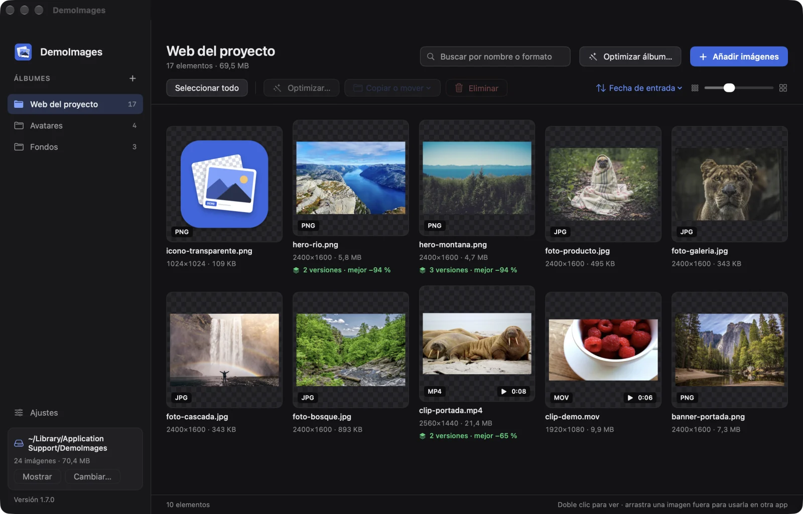
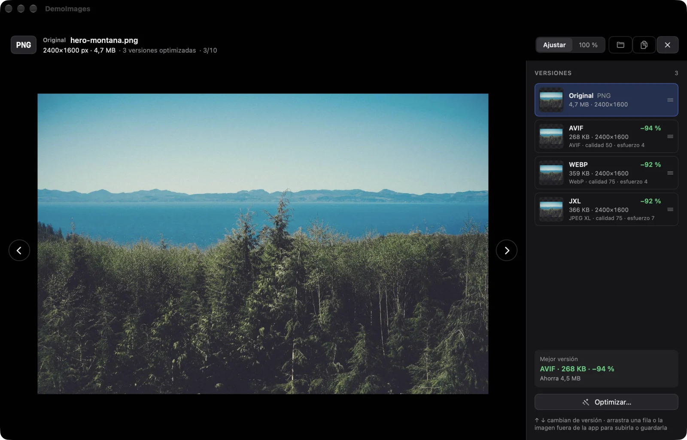
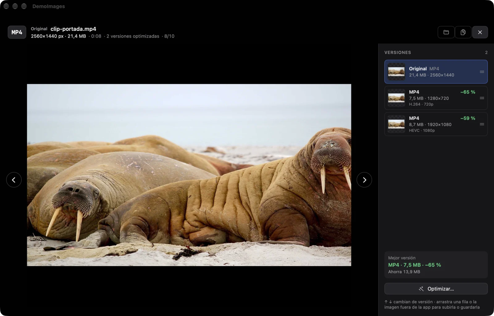
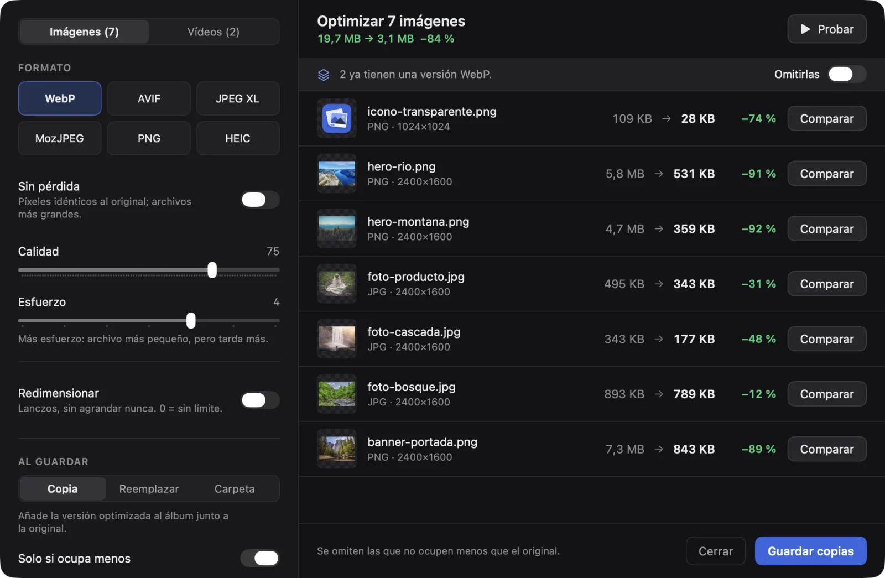
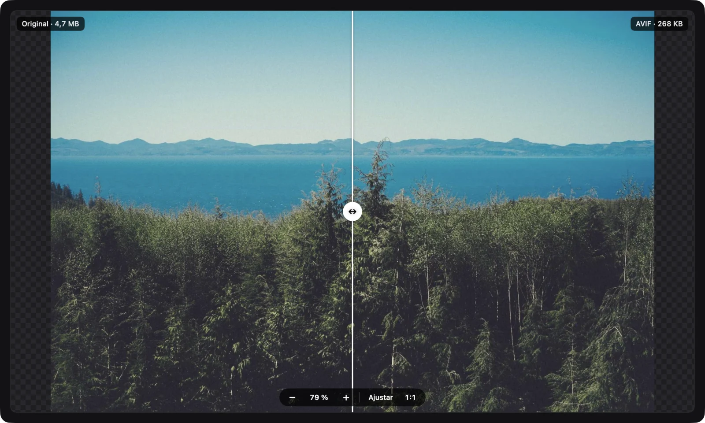

# DemoImages

Tu almacén de imágenes y vídeos de prueba para macOS. Guarda los archivos que usas para probar cosas (subidas, avatares, fondos, PNG con transparencia, fotos enormes, clips de vídeo…) ordenados en álbumes, para no volver a descargarlos cada vez, y optimízalos a formatos modernos: las imágenes con los mismos codificadores que [Squoosh](https://squoosh.app) y los vídeos a HEVC o H.264.



## Instalar

Abre Terminal y pega:

```sh
curl -fsSL https://raw.githubusercontent.com/drarekx/DemoImages/main/install.sh | bash
```

El instalador descarga la última versión, la copia en `/Applications`, la abre y, si tienes [Homebrew](https://brew.sh), instala los codificadores (`webp`, `libavif`, `jpeg-xl`, `mozjpeg`, `oxipng`, `pngquant`). Para no instalarlos:

```sh
curl -fsSL https://raw.githubusercontent.com/drarekx/DemoImages/main/install.sh | bash -s -- --no-deps
```

DemoImages se actualiza sola: busca versiones nuevas al arrancar y una vez al día (o desde el menú → **Buscar actualizaciones…**), comprueba la descarga con su SHA-256 y se reinicia ya actualizada. Se puede desactivar en Ajustes. Volver a ejecutar el comando de instalación también actualiza.

**Instalación manual:** descarga `DemoImages.zip` de [Releases](https://github.com/drarekx/DemoImages/releases/latest), descomprímelo y mueve `DemoImages.app` a Aplicaciones. La app no está notarizada, así que la primera vez ábrela con clic derecho → **Abrir**.

Requisitos: macOS 14 (Sonoma) o posterior. Apple Silicon o Intel.

## Qué hace

### Álbumes y galería

- **Álbumes** con nombre en la barra lateral: crear, renombrar (doble clic en el título) y eliminar (van a la papelera).
- **Añadir imágenes y vídeos** (MP4, MOV, M4V y lo que macOS sepa leer): botón, arrastrar archivos o carpetas enteras, pegar con ⌘V (archivos copiados en Finder o una captura copiada al portapapeles), arrastrarlos al icono del Dock o «Abrir con».
- **Galería** con miniaturas, tamaño ajustable, fondo de cuadros para ver la transparencia, formato, dimensiones y peso de cada archivo (y duración en los vídeos); búsqueda por nombre o formato (`webp`, `png`, `mp4`…) y orden por fecha, nombre, tamaño o dimensiones.
- **Selección** con clic, ⌘-clic, ⇧-clic, ⌘A o «Seleccionar todo»; el pie muestra cuántas hay y cuánto ocupan.
- **Copiar o mover** las seleccionadas a una carpeta del Mac o a otro álbum. ⌘C o botón derecho → «Copiar» (en la galería, en el visor, en cada versión y en la comparación) copia el archivo y la imagen: en el Finder se pega el archivo y en un formulario web, chat o documento, la imagen (de un vídeo se copia solo el archivo). También se pueden arrastrar fuera de la app.
- Debajo de cada original se ve cuántas versiones optimizadas tiene y cuánto ahorra la mejor («3 versiones · mejor −94 %»).

### Visor y versiones



- **Visor** a pantalla completa (doble clic): ← / → para pasar, `0` para ver al 100 %, Esc para cerrar. Arriba se ve claramente qué archivo es (formato, original o versión, tamaño, % frente al original y ajustes).
- **Versiones**: cada archivo optimizado como copia queda enlazado a su original. El panel de la derecha muestra el original y todas sus versiones con tamaño, % de ahorro y ajustes usados; ↑ / ↓ cambian de versión y C la compara con el original.
- La imagen y cada fila del panel se pueden **arrastrar fuera** de la app (a un formulario web, al Finder…).
- En la galería las versiones se agrupan dentro del original (se puede desagrupar desde el menú de orden). Mover, copiar o borrar un original arrastra sus versiones.

### Vídeos



- Los vídeos se guardan en los álbumes junto a las imágenes, con miniatura y duración, y **se reproducen en el visor** (Espacio reproduce o pausa).
- Se optimizan a **HEVC** o **H.264** (MP4) con los ajustes de exportación de macOS, eligiendo la resolución (original, 4K, 1080p, 720p, 540p; nunca se agranda), sin instalar nada.
- Las versiones quedan enlazadas al original igual que con las imágenes, y la comparación con cortinilla se hace sobre un fotograma.

### Optimizar



- **Imágenes** (como Squoosh): WebP, AVIF, JPEG XL, MozJPEG, PNG (OxiPNG + reducción de paleta) y HEIC, con calidad, esfuerzo, sin pérdida y redimensionado Lanczos.
- Primero **prueba**: ves el peso antes y después de cada archivo y el total, sin que nada cambie todavía. Luego guardas como **copia** en el álbum, **reemplazas** los originales (van a la papelera) o **exportas** a una carpeta. Por defecto se omiten los que no salen más pequeños.
- Si se optimizan imágenes y vídeos a la vez, la hoja tiene una pestaña para cada tipo, cada una con sus ajustes.
- **Optimizar un álbum entero** con «Optimizar álbum…»: se omiten las imágenes y los vídeos que ya tienen una versión en el formato elegido (se puede desactivar).

### Comparar



- **Cortinilla antes/después**, en la hoja de optimizar («Comparar») y en el visor (tecla C): arrastra la línea para ver el original a un lado y la versión optimizada al otro.
- Se amplía con la rueda o pellizcando, hacia el puntero, hasta 32×; se mueve arrastrando la imagen o con dos dedos; doble clic alterna entre ajustada y píxeles reales (1:1).

### Biblioteca e idiomas

- **Dónde se guardan**: por defecto en el Mac, o en **iCloud Drive** (Ajustes → «Usar iCloud Drive») o en cualquier carpeta. En iCloud la misma biblioteca se usa desde varios Mac: los cambios del otro aparecen en unos segundos y, si los dos cambian algo a la vez, se combinan. Las imágenes que aún no han llegado de iCloud se ven como «Esperando a iCloud». Al cambiar, la biblioteca se mueve entera; si la carpeta ya tiene una biblioteca (por ejemplo, la de otro Mac en iCloud), se abre esa. Debajo de la barra lateral se ve siempre dónde está y cuánto ocupa todo.
- **Idiomas**: castellano, inglés y catalán.

### Formatos y herramientas

| Formato | Codificador | Sin Homebrew |
|---|---|---|
| WebP | `cwebp` (libwebp) | — |
| AVIF | `avifenc` (libavif) | ImageIO, si el macOS lo permite |
| JPEG XL | `cjxl` (libjxl) | — |
| JPEG | MozJPEG (`cjpeg`) | ImageIO |
| PNG | OxiPNG, `pngquant` para la paleta | ImageIO |
| HEIC | ImageIO | ✓ |
| HEVC, H.264 (vídeo, MP4) | AVFoundation | ✓ |

Los valores por defecto son los de Squoosh (WebP 75 y esfuerzo 4, AVIF 50 y esfuerzo 4, JPEG XL 75 y esfuerzo 7, MozJPEG 75, OxiPNG nivel 2, 256 colores con tramado 1). El botón **Valores de Squoosh** los recupera. En los vídeos no hay calidad ni esfuerzo: macOS elige la tasa de bits según la resolución. WebM y MKV no se pueden importar (macOS no los lee).

## Dónde guarda las cosas

- Imágenes y vídeos: `<biblioteca>/Albums/<id del álbum>/`
- Índice de álbumes: `<biblioteca>/library.json`
- `<biblioteca>` es `~/Library/Application Support/DemoImages` por defecto, o la carpeta elegida en Ajustes (en iCloud Drive: `iCloud Drive/DemoImages`).
- Ajustes: `defaults read com.egluu.demoimages`

## Desinstalar

```sh
osascript -e 'quit app "DemoImages"'
rm -rf /Applications/DemoImages.app ~/Library/Application\ Support/DemoImages   # y la carpeta de iCloud Drive, si la usabas
defaults delete com.egluu.demoimages
```

## Compilar desde el código

```sh
git clone https://github.com/drarekx/DemoImages.git
cd DemoImages
./build-app.sh          # deja build/DemoImages.app y build/DemoImages.zip
open build/DemoImages.app
```

Con Xcode 16+ el binario es universal (arm64 + x86_64); solo con las Command Line Tools se compila para la arquitectura del Mac.

Para publicar una versión nueva, crea y sube una etiqueta; GitHub Actions compila la app y crea el release con el zip:

```sh
git tag v1.0.1 && git push origin v1.0.1
```
